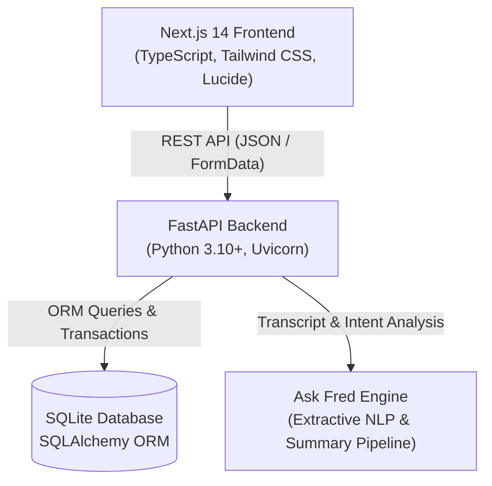
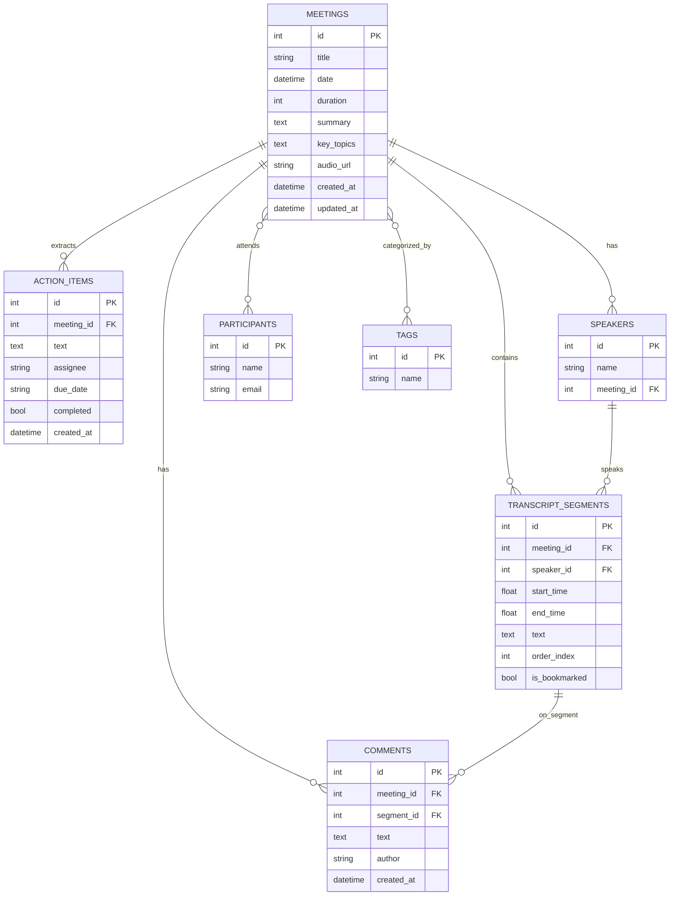

# 🚀 Fireflies.ai Clone — Meeting Notes & AI Transcription Platform

A full-stack clone of the **Fireflies.ai** meeting assistant web application replicating its signature productivity workspace, post-meeting review workflows, and clean design system.

Built for the **SDE Fullstack Assignment** using **Next.js 14 (TypeScript)** on the frontend and **Python with FastAPI & SQLite** on the backend.

---

## 🌟 Key Features

### 1. 📂 Meetings Library / Notebook
- **Fireflies Home View**: Interactive list of meetings with titles, dates, durations, and participant avatar stacks.
- **Search & Filters**: Real-time debounced search by title, participants, and summaries.
- **Multi-criteria Sorting**: Sort by recency, duration, or alphabetical title.
- **Tag System**: Color-coded topic tags (`#product`, `#engineering`, `#sales`, `#design`, `#executive`) with one-click filtering.
- **Productivity Metrics**: Real-time stats banner displaying total meetings, transcribed hours, open action items, and unique attendees.

### 2. 🎙️ Interactive Meeting & Transcript Workspace
- **Custom Synchronized Media Player**:
  - Simulated audio playback with speed controls (`0.75x`, `1x`, `1.25x`, `1.5x`, `2x`).
  - Interactive scrub bar with hover timestamp tooltips and skip backward/forward (`-5s` / `+5s`).
  - Real-time animated 48-bar audio waveform visualizer.
- **Interactive Transcript**:
  - Speaker avatars with consistent color hashing, speaker names, and timestamp pills.
  - **Bidirectional Seeking**: Clicking any transcript timestamp seeks the media player to that second; playing the audio smoothly highlights the current active segment and auto-scrolls.
  - **In-Transcript Search**: Full keyword search with highlighted matches, match counter (e.g. `2/5 matches`), and next/previous match navigation.
  - **Speaker Filter**: Filter transcript view to isolate specific speakers.
  - **Soundbites & Clips**: Bookmark any transcript segment to save it as a highlighted clip.
  - **Segment Comments**: Add notes and discussion threads directly to specific transcript lines.

### 3. 🤖 AI Summary & Notes
- **Executive Summary / TL;DR**: Auto-generated structured summaries of meeting discussions.
- **Clickable Outline & Chapters**: Meeting agenda chapters with clickable timestamps (e.g. `[04:30]`) that immediately seek audio playback to that section.
- **Action Items & Tasks**:
  - Full CRUD: Add, edit, check-to-complete, and delete action items.
  - Assignee badges and due dates for accountable follow-up.
- **Soundbites Tab**: Centralized view of all saved soundbites with instant audio seek.

### 4. 🧠 Ask Fred — AI Meeting Copilot
- Floating, interactive AI assistant modeled after Fireflies's **Fred**.
- Answers natural language questions regarding the meeting (e.g. *"What did Maya say about latency?"*, *"What are the action items?"*, *"Who attended?"*).
- Provides source citations referencing the exact transcript timestamps.
- One-click suggested prompt chips for instant answers.

### 5. 🛠️ Meeting Management (CRUD) & Ingestion
- **Multiple Creation Modes**:
  1. **Upload Transcript File**: Drag & drop `.txt`, `.vtt`, or `.json` transcript files.
  2. **Paste Transcript**: Paste raw dialogue (with or without timestamps) and automatically generate summaries and action items.
  3. **Manual Form**: Create meetings with custom metadata, participants, and tags.
- **Edit & Delete**: Full metadata editing and cascade-safe deletion.

### 6. 🌐 Bonus Features Implemented
- ✅ **Global Action Items Center (`/tasks`)**: Cross-meeting task dashboard with status filters (All, Pending, Completed), assignee filtering, and direct links back to origin meetings.
- ✅ **Global Search (`Ctrl+K`)**: Modal search across all meetings and transcript segments with real-time match previews.
- ✅ **Export Formats**: One-click download as formatted Markdown (`.md`), Plain Text (`.txt`), or browser Print view.
- ✅ **Light & Dark Theme**: Sleek toggle with localStorage persistence and CSS dark mode styling.
- ✅ **Live Bot Placeholder**: "Add Fred to Live Meeting" dialog for Zoom, Google Meet, and Teams.
- ✅ **Integrations & Settings Hub**: Fireflies integration directory and workspace configuration panels.

---

## 🏗️ Architecture & Tech Stack



- **Frontend**: Next.js 14 (App Router), TypeScript, Tailwind CSS, Lucide React, React Hot Toast.
- **Backend**: Python 3.10+, FastAPI, SQLAlchemy ORM, Pydantic v2, Uvicorn.
- **Database**: SQLite (file-based relational persistence with foreign keys and cascade rules).

---

## 🗄️ Database Schema Design

The SQLite relational database schema is structured as follows:



### Schema Highlights:
- **`meetings`**: Core meeting record with duration in seconds, generated summary, and outline topics.
- **`transcript_segments`**: Sequential spoken segments with `start_time` and `end_time` (float seconds) for audio seeking, linked to `speakers`, with `is_bookmarked` flag for soundbites.
- **`action_items`**: Tracked tasks with `completed` boolean, `assignee`, and `due_date`.
- **`meeting_participants` & `meeting_tags`**: Many-to-many junction tables with `CASCADE` on delete.
- **`comments`**: Flexible notes supporting both meeting-level and segment-specific comments.

---

## 📡 API Reference Overview

| Method | Endpoint | Description |
|---|---|---|
| `GET` | `/api/health` | Health check endpoint |
| `GET` | `/api/meetings` | List meetings with `q`, `tag`, `sort_by`, `order` |
| `GET` | `/api/meetings/{id}` | Get detailed meeting with transcripts and notes |
| `POST` | `/api/meetings` | Create meeting with structured JSON payload |
| `POST` | `/api/meetings/from-text` | Create meeting from raw transcript text |
| `POST` | `/api/meetings/upload` | Upload `.txt`/`.vtt`/`.json` transcript file |
| `PUT` | `/api/meetings/{id}` | Update title, participants, tags, summary |
| `DELETE` | `/api/meetings/{id}` | Delete meeting and all related records |
| `GET` | `/api/tasks` | Get all action items across all meetings |
| `POST` | `/api/meetings/{id}/action-items` | Add new action item to meeting |
| `PUT` | `/api/action-items/{id}` | Update action item (text, assignee, completed) |
| `DELETE` | `/api/action-items/{id}` | Delete action item |
| `POST` | `/api/segments/{id}/bookmark` | Toggle soundbite / bookmark on segment |
| `POST` | `/api/meetings/{id}/comments` | Add comment to meeting or segment |
| `GET` | `/api/meetings/{id}/comments` | Get all comments for meeting |
| `DELETE` | `/api/comments/{id}` | Delete comment |
| `GET` | `/api/tags` | List all unique tags |
| `GET` | `/api/search` | Global search across titles, summaries, & transcripts |
| `POST` | `/api/meetings/{id}/chat` | Ask Fred AI question about meeting |
| `GET` | `/api/meetings/{id}/export` | Export meeting transcript (`?format=md` or `?format=txt`) |
| `POST` | `/api/seed` | Reset and reseed database with 5 rich sample meetings |

---

## ⚡ Quickstart & Setup Instructions

### Prerequisites
- **Node.js** (v18+) & **npm**
- **Python** (3.10+)

---

### Step 1: Backend Setup (FastAPI)

1. Open a terminal and navigate to `backend/`:
   ```bash
   cd backend
   ```
2. Install Python dependencies:
   ```bash
   pip install -r requirements.txt
   ```
3. Seed the SQLite database with 5 rich sample meetings:
   ```bash
   python seed.py
   ```
4. Run the automated test suite:
   ```bash
   python test_api.py
   ```
5. Start the FastAPI development server:
   ```bash
   uvicorn main:app --reload --port 8000
   ```
   *The API will be available at `http://localhost:8000`, and interactive Swagger documentation at `http://localhost:8000/docs`.*

---

### Step 2: Frontend Setup (Next.js)

1. Open a second terminal and navigate to `frontend/`:
   ```bash
   cd frontend
   ```
2. Install dependencies:
   ```bash
   npm install
   ```
3. Start the Next.js development server:
   ```bash
   npm run dev
   ```
4. Open [http://localhost:3000](http://localhost:3000) in your browser.

---

## 🧪 Seeded Sample Meetings

The database seeds with 5 complete, realistic meetings ready for immediate review:

1. **Q3 Product Strategy & AI Copilot Roadmap** (23 min, 10 transcript segments, 4 action items)
2. **Enterprise Client Discovery: Acme Corp Implementation** (31 min, 9 transcript segments, 3 action items)
3. **Weekly Engineering Standup & Incident Review** (22 min, 7 transcript segments, 3 action items)
4. **UI/UX Design Sprint: Mobile App Redesign** (38 min, 6 transcript segments, 3 action items)
5. **Executive Briefing: H1 Revenue & Growth Trajectory** (28 min, 6 transcript segments, 3 action items)

*You can reseed the database anytime via the UI using the **"Reseed Sample Data"** button in the sidebar or by calling `POST /api/seed`.*

---

## 🚢 Deployment Guide

### Deploy Backend (Render / Railway)
1. Set the root directory to `backend/`.
2. Build command: `pip install -r requirements.txt && python seed.py`
3. Start command: `uvicorn main:app --host 0.0.0.0 --port $PORT`

### Deploy Frontend (Vercel)
1. Set root directory to `frontend/`.
2. Set Environment Variable:
   - `NEXT_PUBLIC_API_URL`: Your deployed backend URL + `/api` (e.g. `https://my-backend.onrender.com/api`)
3. Framework Preset: Next.js.
