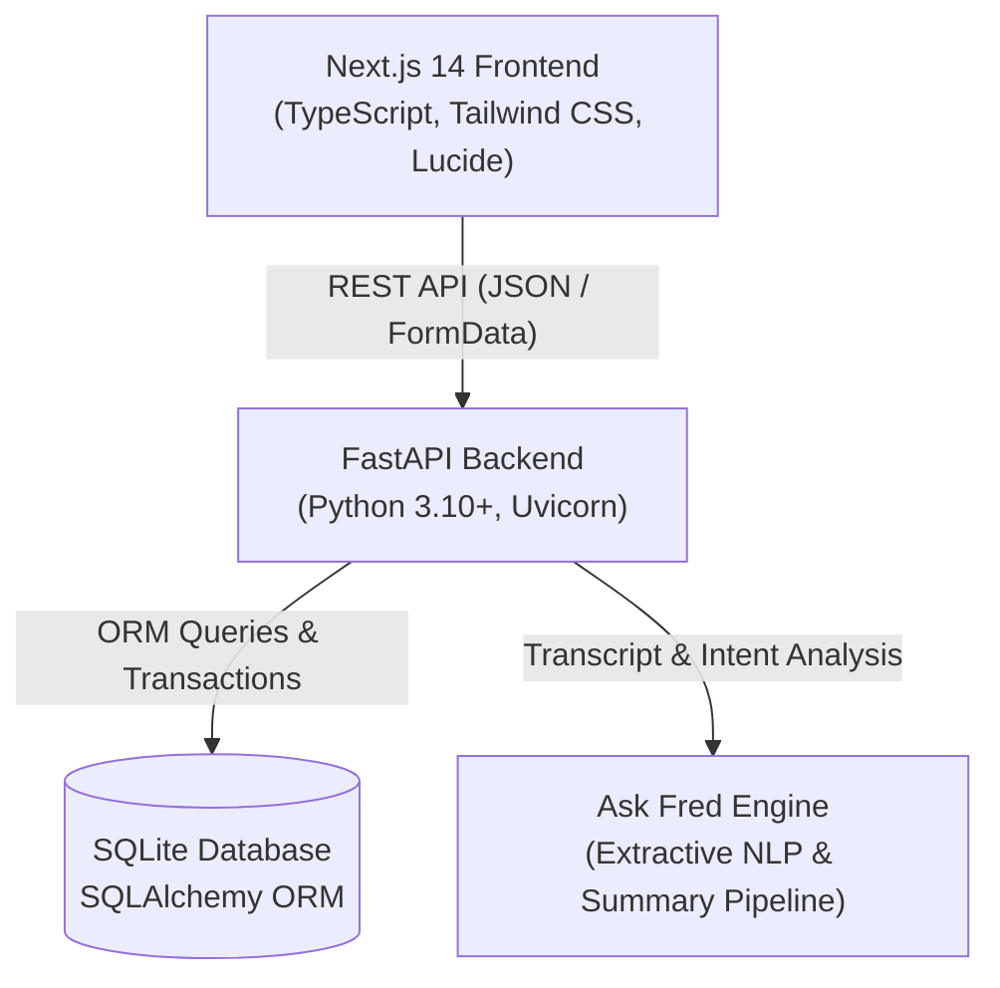
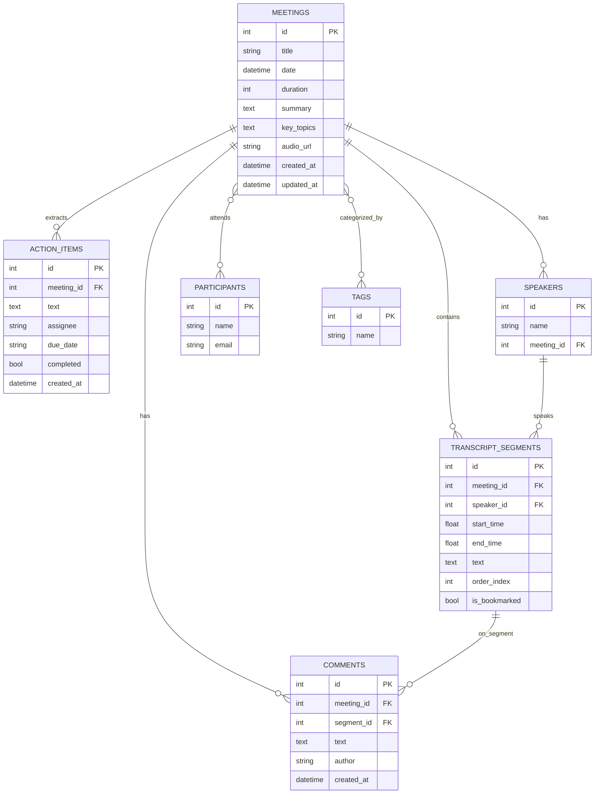

# 🚀 Fireflies.ai Clone — Meeting Notes & AI Transcription Platform

A full-stack clone of the **Fireflies.ai** meeting assistant web application replicating its signature productivity workspace, post-meeting review workflows, and clean design system.

Built for the **SDE Fullstack Assignment** using **Next.js 14 (TypeScript)** on the frontend and **Python with FastAPI & SQLite** on the backend.

---

## 🌟 Key Features

### 1. 📂 Meetings Library / Notebook
- **Fireflies Home View**: Interactive list of meetings with titles, dates, durations, and participant avatar stacks.
- **Search & Filters**: Real-time debounced search by title, participants, and summaries.
- **Multi-criteria Sorting**: Sort by recency, duration, or alphabetical title.
- **Tag System**: Color-coded topic tags (`#product`, `#engineering`, `#sales`, `#design`, `#executive`) with one-click filtering.
- **Productivity Metrics**: Real-time stats banner displaying total meetings, transcribed hours, open action items, and unique attendees.

### 2. 🎙️ Interactive Meeting & Transcript Workspace
- **Custom Synchronized Media Player**:
  - Simulated audio playback with speed controls (`0.75x`, `1x`, `1.25x`, `1.5x`, `2x`).
  - Interactive scrub bar with hover timestamp tooltips and skip backward/forward (`-5s` / `+5s`).
  - Real-time animated 48-bar audio waveform visualizer.
- **Interactive Transcript**:
  - Speaker avatars with consistent color hashing, speaker names, and timestamp pills.
  - **Bidirectional Seeking**: Clicking any transcript timestamp seeks the media player to that second; playing the audio smoothly highlights the current active segment and auto-scrolls.
  - **In-Transcript Search**: Full keyword search with highlighted matches, match counter (e.g. `2/5 matches`), and next/previous match navigation.
  - **Speaker Filter**: Filter transcript view to isolate specific speakers.
  - **Soundbites & Clips**: Bookmark any transcript segment to save it as a highlighted clip.
  - **Segment Comments**: Add notes and discussion threads directly to specific transcript lines.

### 3. 🤖 AI Summary & Notes
- **Executive Summary / TL;DR**: Auto-generated structured summaries of meeting discussions.
- **Clickable Outline & Chapters**: Meeting agenda chapters with clickable timestamps (e.g. `[04:30]`) that immediately seek audio playback to that section.
- **Action Items & Tasks**:
  - Full CRUD: Add, edit, check-to-complete, and delete action items.
  - Assignee badges and due dates for accountable follow-up.
- **Soundbites Tab**: Centralized view of all saved soundbites with instant audio seek.

### 4. 🧠 Ask Fred — AI Meeting Copilot
- Floating, interactive AI assistant modeled after Fireflies's **Fred**.
- Answers natural language questions regarding the meeting (e.g. *"What did Maya say about latency?"*, *"What are the action items?"*, *"Who attended?"*).
- Provides source citations referencing the exact transcript timestamps.
- One-click suggested prompt chips for instant answers.

### 5. 🛠️ Meeting Management (CRUD) & Ingestion
- **Multiple Creation Modes**:
  1. **Upload Transcript File**: Drag & drop `.txt`, `.vtt`, or `.json` transcript files.
  2. **Paste Transcript**: Paste raw dialogue (with or without timestamps) and automatically generate summaries and action items.
  3. **Manual Form**: Create meetings with custom metadata, participants, and tags.
- **Edit & Delete**: Full metadata editing and cascade-safe deletion.

### 6. 🌐 Bonus Features Implemented
- ✅ **Global Action Items Center (`/tasks`)**: Cross-meeting task dashboard with status filters (All, Pending, Completed), assignee filtering, and direct links back to origin meetings.
- ✅ **Global Search (`Ctrl+K`)**: Modal search across all meetings and transcript segments with real-time match previews.
- ✅ **Export Formats**: One-click download as formatted Markdown (`.md`), Plain Text (`.txt`), or browser Print view.
- ✅ **Light & Dark Theme**: Sleek toggle with localStorage persistence and CSS dark mode styling.
- ✅ **Live Bot Placeholder**: "Add Fred to Live Meeting" dialog for Zoom, Google Meet, and Teams.
- ✅ **Integrations & Settings Hub**: Fireflies integration directory and workspace configuration panels.

---

## 🏗️ Architecture & Tech Stack



- **Frontend**: Next.js 14 (App Router), TypeScript, Tailwind CSS, Lucide React, React Hot Toast.
- **Backend**: Python 3.10+, FastAPI, SQLAlchemy ORM, Pydantic v2, Uvicorn.
- **Database**: SQLite (file-based relational persistence with foreign keys and cascade rules).

---

## 🗄️ Database Schema Design

The SQLite relational database schema is structured as follows:



### 🧠 Database Schema Design & Architectural Reasoning

The database schema is purposefully engineered to model the complex multi-party conversational domain of meeting intelligence platforms like Fireflies.ai:

#### 1. Why SQLite with SQLAlchemy ORM?
- **Zero-Friction Reproducibility**: SQLite requires zero local daemon installation (no external PostgreSQL or Docker setup), allowing interview evaluators to immediately clone and run the application in seconds.
- **ACID Transaction Compliance**: SQLite natively supports atomic transactions and foreign key constraints, which are fully enforced through SQLAlchemy's transactional session management.
- **Production Portability**: Because all models are defined via standard SQLAlchemy ORM abstractions, switching to PostgreSQL or CockroachDB in enterprise production only requires changing the connection string URL without altering schema code.

#### 2. Separation of `Participants` and `Speakers` (Domain Modeling)
- In meeting intelligence systems, a **`Participant`** is an invited attendee entity tied to an identity (name, email) who may attend multiple meetings across the organization.
- A **`Speaker`** represents an acoustic/voice-diarized track extracted specifically from an individual meeting recording session.
- By decoupling `Speaker` from `Participant`, the system gracefully accommodates multi-speaker meetings where voice tracks might be recognized before attendee profiles are matched, or where guest speakers without account profiles participate.

#### 3. Granular Time-Seeking via `TranscriptSegment`
- Spoken audio is broken down into contiguous segments with `start_time` and `end_time` stored as IEEE floating-point numbers (`Float`) in seconds.
- Floating-point seconds enable sub-second precision (e.g. `124.5s`), ensuring seamless bidirectional audio seek between the media scrubber and the active transcript turn.
- An indexed `order_index` integer guarantees deterministic chronological sorting.
- The `is_bookmarked` boolean flag enables Fireflies's signature Soundbite clipping workflow.

#### 4. Action Items & Cross-Meeting Aggregation
- `ActionItem` entities store actionable deliverables with an `assignee` badge, `due_date`, and boolean `completed` state.
- Because `ActionItem` has a direct foreign key to `Meeting`, the system efficiently serves both meeting-scoped task lists and global cross-meeting task aggregation at `/tasks`.

#### 5. Polymorphic Commenting Architecture
- The `Comment` entity features both `meeting_id` and an optional `segment_id`.
- This enables users to attach high-level meeting notes (when `segment_id` is null) or comment directly on a specific transcript turn (when `segment_id` is populated).

#### 6. Foreign Key Cascades & Data Integrity
- All subordinate tables (`transcript_segments`, `speakers`, `action_items`, `comments`, and junction tables `meeting_participants`, `meeting_tags`) define `ondelete="CASCADE"`.
- Deleting a meeting automatically purges all transcripts, extracted action items, soundbites, and comments, preventing orphan rows and maintaining database hygiene.

---

## 📡 API Reference Overview

| Method | Endpoint | Description |
|---|---|---|
| `GET` | `/api/health` | Service health check |
| `GET` | `/api/meetings` | List meetings with filters (`q`, `tag`, `date_filter`, `sort_by`, `order`) |
| `GET` | `/api/meetings/{id}` | Retrieve full meeting detail with transcripts, summary, and action items |
| `POST` | `/api/meetings` | Create meeting with structured JSON payload |
| `POST` | `/api/meetings/from-text` | Create meeting from raw transcript text (auto-extracts speakers & AI notes) |
| `POST` | `/api/meetings/upload` | Upload `.txt`, `.vtt`, or `.json` transcript file |
| `PUT` | `/api/meetings/{id}` | Update meeting metadata (title, participants, tags, summary) |
| `DELETE` | `/api/meetings/{id}` | Delete meeting and all associated records (cascaded) |
| `GET` | `/api/tasks` | Global action items center across all meetings |
| `POST` | `/api/meetings/{id}/action-items` | Create new action item for a meeting |
| `PUT` | `/api/action-items/{id}` | Update action item (toggle complete, edit text, assignee, due date) |
| `DELETE` | `/api/action-items/{id}` | Delete action item |
| `POST` | `/api/segments/{id}/bookmark` | Toggle soundbite / bookmark on transcript segment |
| `POST` | `/api/meetings/{id}/comments` | Add comment to meeting or transcript turn |
| `GET` | `/api/meetings/{id}/comments` | Retrieve comments for meeting |
| `DELETE` | `/api/comments/{id}` | Delete comment |
| `GET` | `/api/tags` | List all unique topic tags |
| `GET` | `/api/search` | Global search across titles, summaries, and transcripts |
| `POST` | `/api/meetings/{id}/chat` | Ask Fred AI conversational query with timestamp citations |
| `GET` | `/api/meetings/{id}/export` | Export meeting transcript (`format=md` or `format=txt`) |
| `POST` | `/api/seed` | Reset and reseed database with 5 rich sample meetings |

---

## 💻 How to Run in Visual Studio Code (VS Code)

This repository includes first-class Visual Studio Code configuration in `.vscode/` so you can launch the entire stack with zero manual terminal juggling.

### Method 1: One-Click via VS Code Tasks (Recommended)
1. Open this repository in **VS Code** (`File` -> `Open Folder...`).
2. Press `Ctrl + Shift + P` (or `Cmd + Shift + P` on macOS) and type **Tasks: Run Task**.
3. Select **Start Full Platform (Backend + Frontend)**.
4. VS Code will launch both the FastAPI backend (port 8000) and Next.js frontend (port 3000) simultaneously in dedicated terminal tabs!
5. Open [http://localhost:3000](http://localhost:3000) in your browser.

### Method 2: One-Click via Run Scripts
- **On Windows (Double-Click)**: Double-click `run.bat` in File Explorer or run `./run.bat` in your terminal.
- **On PowerShell**: Run `powershell -ExecutionPolicy Bypass -File run.ps1`.

### Method 3: VS Code Run & Debug (F5)
1. Switch to the **Run and Debug** view (`Ctrl + Shift + D`).
2. Select **Full Stack (Backend + Chrome)** or **FastAPI Backend**.
3. Press **F5** to start debugging with live breakpoints.

---

## ⚡ Manual Terminal Setup Instructions

### Prerequisites
- **Node.js** (v18+) & **npm**
- **Python** (3.10+)

### Step 1: Backend Setup (FastAPI)
1. Open a terminal and navigate to `backend/`:
   ```bash
   cd backend
   ```
2. Install Python dependencies:
   ```bash
   pip install -r requirements.txt
   ```
3. Seed the SQLite database with 5 rich sample meetings:
   ```bash
   python seed.py
   ```
4. Run the automated test suite:
   ```bash
   python test_api.py
   ```
5. Start the FastAPI development server:
   ```bash
   uvicorn main:app --reload --port 8000
   ```
   *The API will be available at `http://localhost:8000`, and interactive Swagger documentation at `http://localhost:8000/docs`.*

### Step 2: Frontend Setup (Next.js)
1. Open a second terminal and navigate to `frontend/`:
   ```bash
   cd frontend
   ```
2. Install dependencies:
   ```bash
   npm.cmd install
   ```
   *(Note: On Windows PowerShell, use `npm.cmd` if your system execution policy restricts `npm.ps1`)*
3. Start the Next.js development server:
   ```bash
   npm.cmd run dev
   ```
4. Open [http://localhost:3000](http://localhost:3000) in your browser.

---

## 🧪 Seeded Sample Meetings

The database seeds with 5 complete, realistic meetings ready for immediate review:

1. **Q3 Product Strategy & AI Copilot Roadmap** (23 min, 10 transcript segments, 4 action items, tags: `#product`, `#ai-roadmap`, `#q3-planning`)
2. **Enterprise Client Discovery: Acme Corp Implementation** (31 min, 9 transcript segments, 3 action items, tags: `#sales`, `#enterprise`, `#security`)
3. **Weekly Engineering Standup & Incident Review** (22 min, 7 transcript segments, 3 action items, tags: `#engineering`, `#infrastructure`, `#devops`)
4. **UI/UX Design Sprint: Mobile App Redesign** (38 min, 6 transcript segments, 3 action items, tags: `#design`, `#mobile`, `#figma`)
5. **Executive Briefing: H1 Revenue & Growth Trajectory** (28 min, 6 transcript segments, 3 action items, tags: `#executive`, `#finance`, `#board`)

*You can reseed the database anytime via the UI using the **"Reseed Sample Data"** button in the sidebar or by calling `POST /api/seed`.*

---

## 📋 Comprehensive Assignment Verification Matrix

| Category | Requirement | Implementation Status | Evidence / Location |
|---|---|---|---|
| **Tech Stack** | Frontend: Next.js (TypeScript) | ✅ Complete | Next.js 14 App Router, TypeScript, Tailwind CSS |
| **Tech Stack** | Backend: Python with FastAPI | ✅ Complete | FastAPI REST API, Pydantic v2, Uvicorn |
| **Tech Stack** | Database: SQLite | ✅ Complete | SQLite with SQLAlchemy ORM & cascading foreign keys |
| **Feature 1** | Meetings Library / Dashboard | ✅ Complete | `src/app/page.tsx` Fireflies notebook with channel rail & stats |
| **Feature 1** | Search & Filter (title, date, participant) | ✅ Complete | Title, participant, tag, and date range filters (Today, 7d, 30d) |
| **Feature 1** | Sort by Recency | ✅ Complete | Sort by recency, duration, or title (asc/desc) |
| **Feature 1** | Navbar with Profile/Settings Placeholders | ✅ Complete | `Navbar.tsx` with search, notifications, profile |
| **Feature 2** | Interactive Transcript | ✅ Complete | `TranscriptView.tsx` with speaker avatars, color hashing, timestamps |
| **Feature 2** | Media Player with Seek Bar | ✅ Complete | `MediaPlayer.tsx` with 48-bar waveform, scrubber, hover time tooltip |
| **Feature 2** | Bidirectional Seeking | ✅ Complete | Clicking transcript line seeks player; playing audio highlights line |
| **Feature 2** | Search within Transcript | ✅ Complete | Match counter (`2/8`), prev/next navigation, highlighted `<mark>` |
| **Feature 3** | AI Meeting Summary | ✅ Complete | Executive overview, key takeaways, copy summary in `SummaryPanel.tsx` |
| **Feature 3** | Action Items / Tasks | ✅ Complete | `ActionItemList.tsx` with checkboxes, assignees, due dates, CRUD |
| **Feature 3** | Key Topics / Outline / Chapters | ✅ Complete | Clickable chapter timestamps `[04:30]` that immediately seek audio |
| **Feature 4** | Meeting CRUD | ✅ Complete | Create (upload file / paste / form), edit metadata, delete |
| **Feature 4** | Task CRUD | ✅ Complete | Add, edit text, toggle completed, delete action items |
| **Feature 4** | Data Persistence | ✅ Complete | All changes persisted in `fireflies.db` SQLite database |
| **Feature 5** | Fireflies Experience | ✅ Complete | Fireflies sidebar, Notepad workspace, Smart Search rail |
| **Placeholder** | Live Bot Modal | ✅ Complete | `LiveBotModal.tsx` simulates adding Fred to Zoom/Meet/Teams |
| **Placeholder** | Integrations Hub | ✅ Complete | `src/app/integrations/page.tsx` with Zoom, Meet, Teams, Slack, CRM |
| **Placeholder** | Team & Collaboration | ✅ Complete | `src/app/team/page.tsx` with workspace members and invite action |
| **Bonus** | Comments on Segments | ✅ Complete | In-thread comments on individual transcript turns |
| **Bonus** | Soundbites / Highlights | ✅ Complete | One-click bookmarking on segments + dedicated Soundbites view |
| **Bonus** | Export (Markdown / TXT / Print) | ✅ Complete | `ExportModal.tsx` one-click downloads formatted `.md` and `.txt` |
| **Bonus** | Global Search (`Ctrl+K`) | ✅ Complete | `GlobalSearchModal.tsx` searching across all meetings & transcripts |
| **Bonus** | Tags & Topic Filtering | ✅ Complete | Clickable topic channel tags with live meeting counts |
| **Bonus** | Ask Fred AI Copilot | ✅ Complete | `AskFredPanel.tsx` with citations and prompt suggestions |
| **Bonus** | Dark Mode Toggle | ✅ Complete | Persistent dark/light theme switch in sidebar |

---

## 🚢 Deployment Guide

### Deploy Backend (Render / Railway)
1. Set the root directory to `backend/`.
2. Build command: `pip install -r requirements.txt && python seed.py`
3. Start command: `uvicorn main:app --host 0.0.0.0 --port $PORT`

### Deploy Frontend (Vercel)
1. Set root directory to `frontend/`.
2. Set Environment Variable:
   - `NEXT_PUBLIC_API_URL`: Your deployed backend URL + `/api` (e.g. `https://my-backend.onrender.com/api`)
3. Framework Preset: Next.js.

